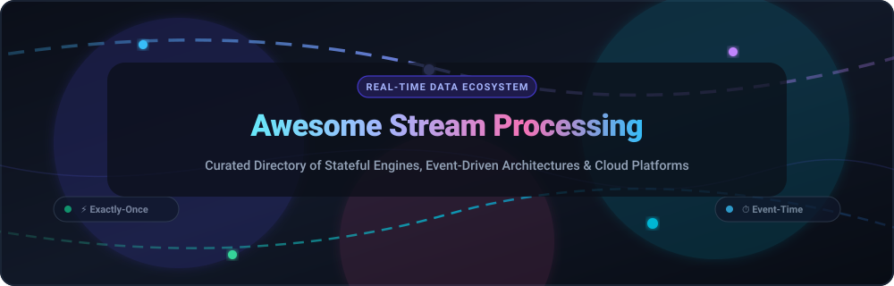

  

  
  
  
  
  
  
  

---

# 🌊 Awesome Stream Processing Frameworks 🚀

> **A comprehensive, SEO-optimized, community-curated directory of premier SaaS platforms and open-source stream processing engines.**  
> *Engineered for real-time data pipelines, stateful computations, event-time windowing, sub-second latency, and exactly-once processing semantics.*

Stream processing frameworks provide the runtime engines, execution semantics, and distributed programming models for continuous computation over unbounded data streams. Whether you are architecting real-time machine learning feature stores, fraud detection pipelines, Internet of Things (IoT) telemetry aggregations, or live materialized views, this repository tracks the leading commercial cloud services and battle-tested open-source projects across the streaming landscape.

---

## 📑 Table of Contents

- [📊 Sector Overview & Market Dynamics](#-sector-overview--market-dynamics)
- [☁️ SaaS & Managed Cloud Streaming Platforms](#️-saas--managed-cloud-streaming-platforms)
- [🛠️ Open-Source Stream Processing Projects](#️-open-source-stream-processing-projects)
  - [🌟 Enterprise Distributed Engines](#-enterprise-distributed-engines)
  - [⚡ Streaming SQL & Incremental Materialized Views](#-streaming-sql--incremental-materialized-views)
  - [🐍 Python-First Stream Frameworks](#-python-first-stream-frameworks)
  - [📦 Lightweight, Embedded & Edge Processors](#-lightweight-embedded--edge-processors)
  - [🔧 Management & Ecosystem Tooling](#-management--ecosystem-tooling)
- [📐 Stream Framework Selection Matrix](#-stream-framework-selection-matrix)
- [🤝 How to Contribute](#-how-to-contribute)
- [💖 Support & Sponsoring](#-support--sponsoring)
- [⭐ Star History](#-star-history)
- [📜 Disclaimer](#-disclaimer)

---

## 📊 Sector Overview & Market Dynamics

- **Estimated Market Size**: The global stream processing and streaming analytics market was valued at **$24.8 Billion in 2024** and is projected to reach **$86.5 Billion by 2030**, advancing at a robust compound annual growth rate (**CAGR of ~23.1%**). This acceleration is propelled by enterprise demands for real-time AI/LLM inference, streaming change data capture (CDC), fraud and risk mitigation, and instant customer engagement pipelines.
- **Market Dynamics & Fragmentation**: The market exhibits a **bifurcated, moderately concentrated structure** at the cloud infrastructure layer—anchored by hyperscalers (Microsoft Azure, Google Cloud, AWS) and category leader Confluent for enterprise Kafka. In contrast, the modern stream processing engine layer remains **highly fragmented and aggressively competitive**, with cutting-edge open-source and specialized systems (RisingWave, Timeplus, Arroyo, Bytewax, Feldera) disrupting incumbents through Rust/C++ execution engines, unified streaming SQL, disaggregated cloud-native storage, and sub-millisecond event-time latencies.

---

## ☁️ SaaS & Managed Cloud Streaming Platforms

The table below compiles leading fully managed stream processing and streaming data services, **sorted descending by company size** (market capitalization or latest enterprise valuation).

| 🏢 Platform / Service | 🏛️ Parent Company | 📈 Company Scale (Valuation / Revenue) | ⚙️ Architecture & Core Engine | 💰 Starting Pricing | 🎁 Free Tier / Trial Limits | 🌐 Links |
| :--- | :--- | :--- | :--- | :--- | :--- | :--- |
| **[Azure Stream Analytics](https://azure.microsoft.com/en-us/products/stream-analytics/)** | Microsoft (NASDAQ: MSFT) | **~$3.15 Trillion** Market Cap (~$245B Ann. Revenue) | Proprietary distributed SQL streaming engine with sub-second latency; native IoT Hub and Event Hubs integration | **$0.11 / Streaming Unit (SU) per hour** (Standard V2; 1/3 SU fractional node starts at ~$0.037/hr) | **30-day free trial with $200 Azure credits**; 0 permanent free SUs | [Explore Azure](https://azure.microsoft.com/en-us/products/stream-analytics/) |
| **[Google Cloud Dataflow](https://cloud.google.com/dataflow)** | Alphabet / Google (NASDAQ: GOOGL) | **~$2.15 Trillion** Market Cap (~$350B Ann. Revenue) | Fully managed runner for Apache Beam pipelines with horizontal autoscaling, Dynamic Work Rebalancing, and flexible checkpointing | **$0.056 / vCPU-hr + $0.003557 / GB-hr RAM** (~$0.069 / DPU-hr) + $0.011 / GB Shuffle | **90-day free trial with $300 Google Cloud credits**; 0 permanent free streaming workers | [Explore Dataflow](https://cloud.google.com/dataflow) |
| **[AWS Kinesis Data Analytics](https://aws.amazon.com/kinesis/data-analytics/)** *(Managed Service for Apache Flink)* | Amazon Web Services (NASDAQ: AMZN) | **~$2.05 Trillion** Market Cap (~$575B Ann. Revenue) | Serverless Apache Flink, Java, and SQL runtime; deep integration with Kinesis Data Streams, Apache Kafka (MSK), and S3 | **$0.11 / Kinesis Processing Unit (KPU) per hour** (1 KPU = 1 vCPU + 4 GB RAM) + $0.10 / GB-month application storage | **12-month AWS Free Tier** includes 1,000,000 PUT records/month on Kinesis Streams; 0 perpetual free KPUs for Flink runtime | [Explore AWS](https://aws.amazon.com/kinesis/data-analytics/) |
| **[Databricks Structured Streaming](https://www.databricks.com/)** | Databricks, Inc. | **~$43.0 Billion** Private Valuation (~$1.6B+ ARR) | Distributed stream processing on Apache Spark & Delta Lake with exactly-once guarantees, RocksDB state provider, and liquid clustering | **$0.07 / Databricks Unit (DBU) per hour** for Jobs Compute ($0.15 / DBU-hr for All-Purpose Compute) plus cloud VM costs | **14-day free trial** with full platform capabilities on AWS/Azure/GCP; Community Edition is free forever (1 micro-cluster, 15 GB RAM limit) | [Explore Databricks](https://www.databricks.com/) |
| **[Confluent Cloud (ksqlDB)](https://www.confluent.io/product/ksqldb/)** | Confluent, Inc. (NASDAQ: CFLT) | **~$7.20 Billion** Market Cap (~$1.0B ARR) | Managed event streaming database purpose-built for Apache Kafka with streaming SQL push & pull queries and embedded connectors | **$0.11 / partition-hour** for Standard clusters; **$0.12 / Confluent Streaming Unit (CSU) per hour** for ksqlDB pools | **30-day free trial with $400 in usage credits**; 0 perpetual free CSUs | [Explore Confluent](https://www.confluent.io/product/ksqldb/) |
| **[Redpanda Cloud](https://redpanda.com/)** | Redpanda Data, Inc. | **~$600 Million** Valuation ($165M raised) | C++ Kafka-compatible streaming engine with inline WebAssembly data transforms, zero JVM overhead, and tiered S3 object storage | Serverless starts at **$0.038 / GB written + $0.019 / GB read** ($0.10 / GB-month storage); Dedicated clusters from $0.20/hr | **14-day free trial with up to $300 in cloud usage credits** | [Explore Redpanda](https://redpanda.com/) |
| **[Hazelcast Viridian](https://hazelcast.com/)** | Hazelcast, Inc. | **~$250 Million** Valuation ($102M raised) | In-memory distributed compute platform merging fast key-value caching with the Hazelcast Jet streaming engine | Serverless starts at **$0.05 / GB-hour RAM** ($0.00007 / GB-minute); Dedicated instances start at $0.12/hr | **Free forever plan: Up to 2 GB memory cluster and 100,000 operations/sec**; 30-day trial for Dedicated | [Explore Hazelcast](https://hazelcast.com/) |
| **[StreamNative Cloud](https://streamnative.io/)** | StreamNative, Inc. | **~$200 Million** Valuation ($53M raised) | Cloud-native messaging and stream storage built on Apache Pulsar and BookKeeper with Pulsar Functions and Kafka protocol (KoP) | Serverless starts at **$0.08 / GB ingress + $0.10 / cluster-hour**; Dedicated production clusters from $350/month | **30-day free trial with $200 cloud credits**; Perpetual Developer tier free up to 100 MB/day ingress & 5 topics | [Explore StreamNative](https://streamnative.io/) |
| **[Decodable](https://www.decodable.co/)** | Decodable, Inc. | **~$120 Million** Valuation ($55M raised) | Serverless real-time data pipelines and ETL powered by Apache Flink; SQL-first abstractions with managed schema registries | Standard starts at **$0.50 / task-hour** (1 task = 1 vCPU + 4 GB RAM) or **$0.20 / GB processed** | **Free forever Developer tier: Up to 5 pipelines, 2 task slots, and 100 GB processed per month** | [Explore Decodable](https://www.decodable.co/) |

---

## 🛠️ Open-Source Stream Processing Projects

Below are the most prominent open-source stream processing engines, frameworks, and libraries, **sorted descending by GitHub Stars_Count**. Each project includes a live Stars_Badge linking directly to its GitHub stargazers page.

### 🌟 Enterprise Distributed Engines

1. **[Pathway](https://github.com/pathwaycom/pathway)**   
   **High-throughput Python ETL framework for stream processing, real-time analytics, and live LLM pipelines.** Powered by a distributed Rust incremental computation engine. Provides out-of-the-box streaming joins, sliding windows, and real-time vector index updates for RAG architectures.

2. **[Apache Spark](https://github.com/apache/spark)**   
   **Unified analytics engine for large-scale data processing with Structured Streaming.** Offers a unified stream-and-batch DataFrame/Dataset API with micro-batching and continuous execution modes, RocksDB state store providers, event-time watermarking, and ACID transactions via Delta Lake.

3. **[Apache Kafka (Kafka Streams)](https://github.com/apache/kafka)**   
   **Distributed event streaming platform with embedded client-side stream processing.** The Kafka Streams library allows building robust stateful stream processing applications directly inside standard Java/Scala microservices without deploying a dedicated cluster, featuring RocksDB local state and exactly-once processing (EOS).

4. **[Apache Flink](https://github.com/apache/flink)**   
   **The industry standard framework for distributed stateful stream processing over unbounded data.** Provides true event-driven stream computation, sub-second latency, Chandy-Lamport distributed checkpointing, savepoints for zero-downtime upgrades, DataStream APIs, Table API, and streaming SQL.

5. **[Vector](https://github.com/vectordotdev/vector)**   
   **Ultra-high-performance observability data pipeline and stream processor.** Engineered in Rust for extreme memory safety and throughput. Collects, enriches, transforms (via Vector Remap Language - VRL), and routes massive streams of logs, metrics, and event data with on-disk buffering.

6. **[NATS JetStream](https://github.com/nats-io/nats-server)**   
   **Cloud-native messaging system with built-in streaming persistence and processing semantics.** Written in Go for ultra-low latency and tiny resource footprints. JetStream adds persistent streams, message deduplication, at-least-once and exactly-once consumer deliveries, and distributed KV/Object storage.

7. **[Apache Pulsar](https://github.com/apache/pulsar)**   
   **Cloud-native distributed pub-sub messaging and streaming platform.** Decouples compute from storage via Apache BookKeeper and object tiers (S3/GCS). Features native multi-tenancy, geo-replication, Pulsar Functions for serverless event transformations, and Pulsar IO connectors.

8. **[Redpanda Connect (formerly Benthos)](https://github.com/redpanda-data/connect)**   
   **Resilient, single-binary stream processor with 200+ out-of-the-box connectors.** Configured declaratively with Bloblang data mapping language. Excels at multiplexing, enriching, formatting, and filtering streaming data across Kafka, AWS, GCP, Redis, and relational databases.

9. **[Apache Beam](https://github.com/apache/beam)**   
   **Unified, portable programming model for batch and streaming pipelines.** Write pipeline logic once in Java, Python, or Go, and execute across multiple distributed runners including Apache Flink, Apache Spark, and Google Cloud Dataflow without refactoring pipeline semantics.

10. **[Apache Storm](https://github.com/apache/storm)**   
    **Pioneering distributed real-time computation system.** Processes streams using directed acyclic graph (DAG) topologies composed of Spouts (data sources) and Bolts (processing logic), delivering low-latency stream transformations and distributed RPC.

11. **[Hazelcast Platform](https://github.com/hazelcast/hazelcast)**   
    **Unified in-memory computing platform combining memory grid storage with the Hazelcast Jet streaming engine.** Executes greenfield streaming pipelines with sub-millisecond latencies, continuous SQL queries, and unified in-memory data lookups.

12. **[Apache Heron](https://github.com/apache/incubator-heron)**   
    **Cloud-native real-time stream processing engine developed at Twitter as Storm's successor.** Provides process-based isolation for topology components, predictable memory utilization, resource scheduling via Kubernetes and Nomad, and backward compatibility with Storm APIs.

13. **[Apache Samza](https://github.com/apache/samza)**   
    **Distributed stateful stream processing framework developed at LinkedIn.** Built around Apache Kafka log partitions and Apache YARN/Mesos resource allocation, using RocksDB for co-located partition-level state management.

---

### ⚡ Streaming SQL & Incremental Materialized Views

1. **[RisingWave](https://github.com/risingwavelabs/risingwave)**   
   **Distributed SQL streaming database with PostgreSQL wire compatibility and disaggregated storage.** Written in Rust, RisingWave unifies stream ingestion, stateful joins, windowed aggregations, and serving into a single system. Stores internal state in cloud object storage (S3), enabling fast recovery and dynamic horizontal scaling.

2. **[Materialize](https://github.com/MaterializeInc/materialize)**   
   **Streaming database that maintains complex SQL queries incrementally.** Powered by Timely Dataflow and Differential Dataflow, Materialize continuously recalculates ANSI SQL query views as upstream events arrive from Kafka and Postgres CDC, serving queries through standard PostgreSQL drivers.

3. **[Timeplus Proton](https://github.com/timeplus-io/proton)**   
   **Lightweight, C++ stream processing SQL engine powered by ClickHouse core components.** Single binary under 500MB with SIMD vectorization. Capable of handling 90+ Million events/sec with 4ms end-to-end latency, unified historical and streaming queries, and incremental materialized views.

4. **[Feldera](https://github.com/feldera/feldera)**   
   **Incremental computation engine that evaluates arbitrary complex SQL programs continuously.** Processes millions of events per second on commodity hardware, computing incremental updates for joins, windowing, aggregations, and recursive SQL queries over continuous data deltas.

---

### 🐍 Python-First Stream Frameworks

1. **[Bytewax](https://github.com/bytewax/bytewax)**   
   **Python-native stateful stream processing framework powered by a Timely Dataflow Rust runtime.** Provides an intuitive Python API (`map`, `filter`, `fold_window`, `join`) combined with Rust's thread-level performance, making it a premier choice for real-time ML feature pipelines and AI agent workflows.

2. **[Quix Streams](https://github.com/quixio/quix-streams)**   
   **Pure Python streaming library with pandas-like syntax designed for Kafka.** Features RocksDB-backed local state, tumbling/hopping/sliding windows, consumer auto-recovery, and seamless serialization for JSON, Avro, and Protobuf.

---

### 📦 Lightweight, Embedded & Edge Processors

1. **[Fluvio](https://github.com/fluvio-community/fluvio)**   
   **Lean, programmable distributed stream processing platform written in Rust.** Utilizes WebAssembly (WASM) SmartModules for inline stream transformations, filtering, and protocol translation at the broker edge.

2. **[Memphis.dev](https://github.com/superstreamlabs/memphis)**   
   **Next-generation streaming broker and event processing platform.** Offers intuitive developer ergonomics, built-in schema drift prevention, Dead Letter Stations (DLS) for poisoned events, and real-time observability.

3. **[LF Edge eKuiper](https://github.com/lf-edge/ekuiper)**   
   **Ultra-lightweight IoT edge stream processing engine.** Maintained under the Linux Foundation Edge. Requires less than 10MB of memory, supports SQL-based rule engines, MQTT/OPC-UA/Modbus inputs, and edge-to-cloud synchronization.

---

### 🔧 Management & Ecosystem Tooling

1. **[Apache StreamPark](https://github.com/apache/streampark)**   
   **Enterprise stream processing application development framework and management platform.** Simplifies deploying, monitoring, checkpointing, and lifecycle management for Apache Flink and Apache Spark streaming jobs on Kubernetes and YARN.

---

## 📐 Stream Framework Selection Matrix

| Architectural Requirement | Recommended Frameworks / Platforms | Key Trade-offs |
| :--- | :--- | :--- |
| **Complex Stateful Event-Time Logic** | [Apache Flink](https://github.com/apache/flink), [AWS Kinesis/Flink](https://aws.amazon.com/kinesis/data-analytics/), [Google Dataflow](https://cloud.google.com/dataflow) | Full flexibility over timers, state backends, and savepoints; higher operational complexity |
| **Embedded Microservices (No Extra Cluster)** | [Kafka Streams](https://github.com/apache/kafka), [NATS JetStream](https://github.com/nats-io/nats-server) | Zero external cluster orchestration; tightly coupled to specific broker partitions |
| **SQL-First Real-Time Materialized Views** | [RisingWave](https://github.com/risingwavelabs/risingwave), [Timeplus Proton](https://github.com/timeplus-io/proton), [Confluent ksqlDB](https://www.confluent.io/product/ksqldb/) | Direct Postgres/ClickHouse query access; bounded to SQL relational operators |
| **Python ML & AI Inference Pipelines** | [Pathway](https://github.com/pathwaycom/pathway), [Bytewax](https://github.com/bytewax/bytewax), [Quix Streams](https://github.com/quixio/quix-streams) | Pythonic data engineering; requires managing Python GIL or Rust FFI bindings |
| **Observability, Log & Metrics Ingestion** | [Vector](https://github.com/vectordotdev/vector), [Redpanda Connect](https://github.com/redpanda-data/connect) | Blazing fast transformations and routing; stateless or micro-window focused |
| **Edge & Resource-Constrained Gateways** | [LF Edge eKuiper](https://github.com/lf-edge/ekuiper), [Fluvio](https://github.com/fluvio-community/fluvio) | Under 10MB RAM footprint; limited complex join capabilities |

---

## 🤝 How to Contribute

Contributions are welcome and appreciated! Follow these steps to submit additions or updates:

1. **Fork the repository** to your GitHub account.
2. **Add or modify entries** in `README.md` following the established table or categorized formats.
3. **Include verified data**: Project name, official website/repo link, live GitHub Stars_Badge, license, and concrete architecture descriptions.
4. **Submit a Pull Request** with a descriptive title and summary of changes.

---

## 💖 Support & Sponsoring

Thank you for exploring **Awesome Stream Processing Frameworks**! If this curated guide helped you navigate the real-time stream processing ecosystem, please consider supporting the project:

- ⭐ **Star this repository** to help others discover it.
- 🍴 **Fork the repo** to contribute new frameworks, benchmarks, or updates.
- 📢 **Share with colleagues** across your data engineering and platform teams.
- ☕ **Buy me a coffee / Sponsor**: If you find value in my open-source work, consider sponsoring via the [GitHub Sponsors Dashboard](https://github.com/sponsors/ishandutta2007). Your support helps keep this directory continuously maintained and up to date!

---

## ⭐ Star History

---

## 📜 Disclaimer

- This is an independent, community-curated reference list; inclusion does not constitute commercial endorsement.
- Licenses, pricing models, and cloud quotas change over time:
  - **ksqlDB** is licensed under the Confluent Community License (source-available, not OSI open-source).
  - **Redpanda** core is source-available under the Business Source License (BSL).
  - **Materialize** open-source code was sunsetted in favor of their managed cloud offering.
- Stream processing benchmarks are heavily dependent on event volume, payload size, window duration, state backend tuning, and network I/O. Validate latency and memory characteristics against your specific production workloads.

---

  <b>Crafted with passion for data engineers, stream architects, and distributed systems developers.</b> 
  Continuous computation over unbounded data streams made transparent and accessible.

